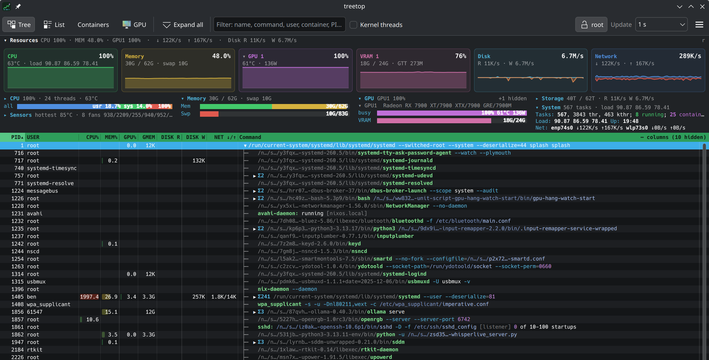
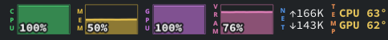
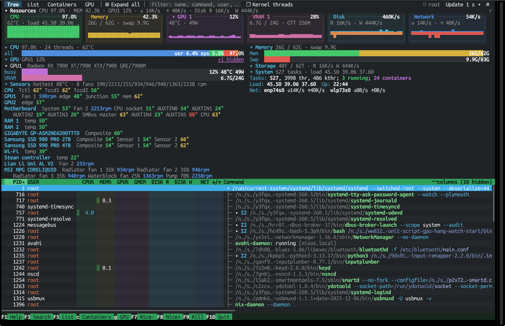
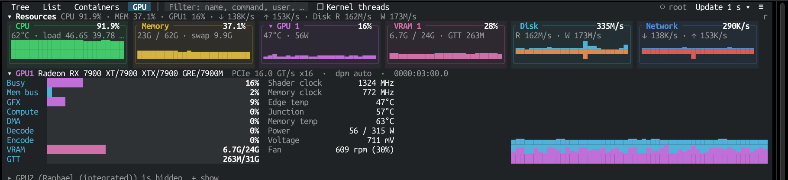

# treetop

**A system monitor for KDE Plasma that shows you everything at once** — every
process as a tree (like htop), live graphs for CPU, memory, GPU, disk and
network (like KStats), every temperature and fan, which program is using
your GPU (like amdgpu_top), and which Docker/Podman container each process
belongs to. It lives in your tray and your panel, and stays out of the way
until you want it.



The panel widget, KStats-style:



## What you get

**A process tree you can actually use**
- Every process with htop's tree lines; click ▸/▾ to fold a branch
  (Shift+click folds or unfolds everything below it).
- A folded branch shows **totals** for everything inside it — CPU, memory,
  GPU, disk and network — so `×214` on `systemd --user` tells you what your
  whole session is using.
- Sort by any column; the list stays calm (idle processes don't reshuffle,
  and the order holds still while your pointer is over it).
- **Focus** on one process (double-click, or `f`) to see only its tree, with a
  clickable breadcrumb back out.
- Command lines are colour-coded (program, flags, values, paths); hover one
  for the full command, one argument per line. Long `/nix/store/…` paths are
  shortened to `/n…/s…/abcde…-name` (configurable).
- Columns: PID, user, CPU%, memory, GPU%, video memory, disk read/write,
  network, container, and more — drag to reorder, drag the gaps to resize,
  double-click a gap to fit, right-click to choose. Hover a header to learn
  what a column means.

**Containers**
- Processes inside Docker/Podman/containerd containers get a coloured stripe,
  and the container's name appears on its shim process.
- The **Containers** view groups processes by container with totals,
  including each container's network traffic.

**GPU, amdgpu_top-style**
- Busy %, memory-controller load, VRAM and GTT, clocks, temperatures, fan,
  power vs. cap, voltage and PCIe link — and per-process GPU use and VRAM.
- The GPU driving your display is GPU 1; an idle second GPU folds away by
  itself (and comes back when it's used).

**Sensors and fans**
- Every temperature and fan Linux exposes: CPU, GPUs, RAM, drives,
  motherboard, Wi-Fi — plus liquid coolers and fan hubs through
  [liquidctl](https://github.com/liquidctl/liquidctl).

**Process details**
- Press `Enter` on a process: its environment variables, open files (with
  network connections shown as real addresses), executable, working
  directory, container, GPU use and more.

**Panel widget and tray**
- A compact KStats-style strip for your panel — CPU, memory, GPU, VRAM, disk,
  network and temperatures, each with a tiny history graph. Hover any of them
  to see **which programs are using it**; click to open or hide treetop.
- In the system tray it shrinks to five little bars.

**Root access, only when you want it**
- Click the 🔒 in the toolbar to see everything for every process — including
  root's: disk I/O, GPU use, network traffic per process, environment, open
  files — and to stop or renice root processes without further prompts.
  treetop asks once through polkit (your normal password prompt) and runs a
  small helper that only reads `/proc` and sends signals.

**In a terminal, too**
- `treetop-tui` is the same monitor in a terminal — same columns, keys,
  menus, details and settings — as a single static binary that runs on any
  Linux (x86_64 or ARM), including over SSH. See
  [the terminal version](#the-terminal-version).

## Install

### AppImage (any Linux distribution)

Download `treetop-<version>-x86_64.AppImage` from the
[latest release](https://github.com/benwbooth/treetop/releases/latest), then:

```sh
chmod +x treetop-*-x86_64.AppImage
./treetop-*-x86_64.AppImage
```

### Nix / NixOS

Try it without installing:

```sh
nix run github:benwbooth/treetop
```

Or add it to your NixOS configuration (flake):

```nix
# flake.nix
inputs.treetop.url = "github:benwbooth/treetop";

# in your configuration
environment.systemPackages = [ inputs.treetop.packages.${pkgs.system}.default ];
```

The package includes the panel widget, so after a rebuild it's in
**Add Widgets…** as *treetop*.

### Flatpak

Coming soon. (Flatpak's sandbox hides other processes, so treetop needs a
small host-side helper to work there; that's in progress.)

### From source

You need Rust and Qt 6.8 or newer (Qt Quick, Quick Controls, D-Bus).

```sh
git clone https://github.com/benwbooth/treetop
cd treetop
nix develop      # optional: a shell with everything needed
cargo build --release
./target/release/treetop
```

### The terminal version

Download `treetop-tui-<version>-x86_64-linux-musl` (or `-aarch64-…` for ARM)
from the [latest release](https://github.com/benwbooth/treetop/releases/latest):

```sh
chmod +x treetop-tui-*-linux-musl
./treetop-tui-*-linux-musl
```

It's one static file with no dependencies; copy it to any Linux machine.
With Nix: `nix run github:benwbooth/treetop#treetop-tui` (the NixOS package
above includes it too).

## Getting started

- **Open it** from your application menu (*treetop*), or run `treetop`.
  Closing the window keeps it in the tray; **Ctrl+Q** quits.
- **Start at login**: ☰ menu → *Start at login (in the tray)*.
- **Add the panel widget**: right-click your panel → *Add Widgets…* → *treetop*.
  Right-click the widget → *Configure* to choose what it shows.
  (Installing by hand from a checkout:
  `kpackagetool6 -t Plasma/Applet -i plasmoid`.)
- **See more**: click the 🔒 to enable root access.

Everything you change — window size and position, columns, sort, filter,
folded branches, sections — is remembered for next time.

### Keys

| Key | Does |
|---|---|
| `↑` `↓` `PgUp` `PgDn` `Home` `End` | move |
| `→` `←` / `+` `−` | expand / collapse |
| `Ctrl+→` `Ctrl+←` | expand / collapse everything below |
| `*` / `_` | expand all / collapse all |
| `Enter` | details |
| `f` or double-click | focus on this process's tree (`Esc` to return) |
| `F9` or `k` | signal menu (also right-click) |
| `F7` / `F8` | nice − / + |
| `Space` | tag a process (Ctrl+click too) |
| `t` / `F5` | tree ⇄ list |
| `c` | containers view |
| `g` | GPU view |
| `1` | per-core ⇄ combined CPU meter |
| `r` | fold the resources area |
| `/` or `F3` | filter |
| `Esc` / `q` | hide to the tray |
| `Ctrl+=` / `Ctrl+-` | font size |

### In the terminal





`treetop-tui` works like the window: the same keys (press `h`), and the
mouse too — click to select, right-click for the signal or column menu,
double-click to focus, drag headers to move columns and column gaps to
resize them, wheel to scroll, hover for the same explanations as the
window's tooltips. `F2` or ☰ opens the options.

- Sideways: ←/→ (as in htop; `+`/`−` fold instead), `<` `>`, Alt or
  Ctrl+wheel (many terminals keep Shift+wheel for themselves), or the
  scrollbar along the bottom.

- It shares settings with the window (`~/.config/treetop/treetop.conf`):
  columns, widths, order, sort, filter, hidden GPUs and folded branches.
- `q`, `F10` or Ctrl+Q quits (there's no tray to hide in).
- Root access asks through polkit on a desktop; over SSH or on a console it
  asks for your `sudo` password on the terminal.
- Colours are true colour where the terminal supports it (most do), else
  the nearest of 256.

## Good to know

- **Missing fans or motherboard temperatures?** Linux only shows what its
  drivers expose. Many desktop boards need their sensor chip's driver
  loaded — for most ASUS/ASRock/MSI boards that's `nct6775`
  (`sudo modprobe nct6775`; on NixOS, `boot.kernelModules = [ "nct6775" ];`).
  Liquid coolers and fan hubs appear when
  [liquidctl](https://github.com/liquidctl/liquidctl) can read them.
- **Some columns are blank for other users' processes** (disk I/O, GPU,
  network, environment): the kernel only shows those to their owner or root.
  Turn on root access (🔒) to see them.
- **Per-process network** needs root access: Linux has no per-process network
  counters, so treetop measures it from packet headers (never contents), the
  way nethogs does. Containers' traffic is always shown per container.

## Credits

Inspired by [htop](https://htop.dev), [KStats](https://github.com/oowl/kstats)
and [amdgpu_top](https://github.com/Umio-Yasuno/amdgpu_top). Built with Rust,
[CXX-Qt](https://github.com/KDAB/cxx-qt) and Qt Quick.

MIT licensed.
